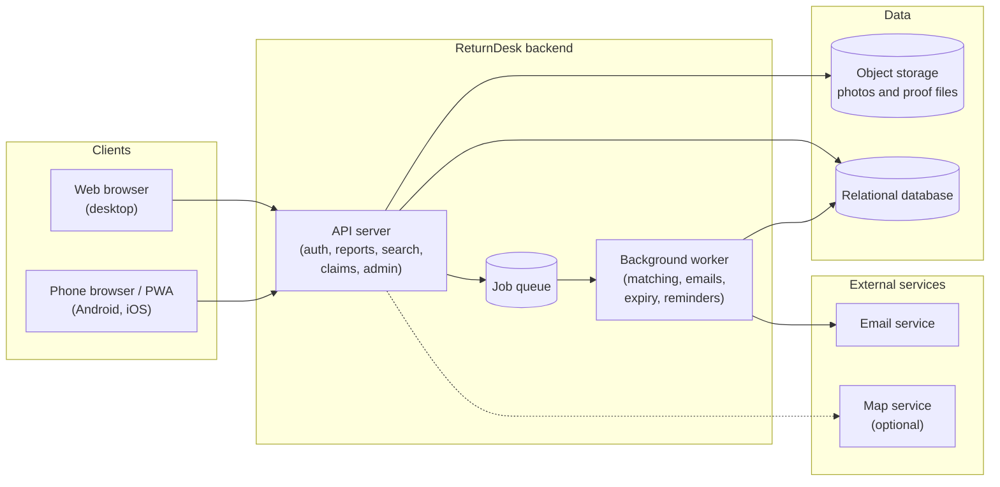
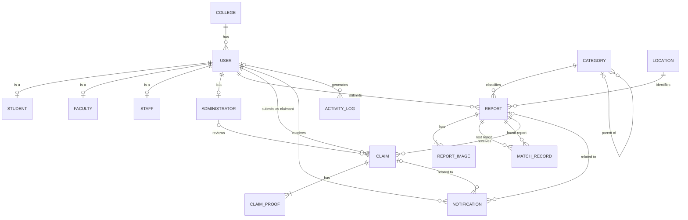
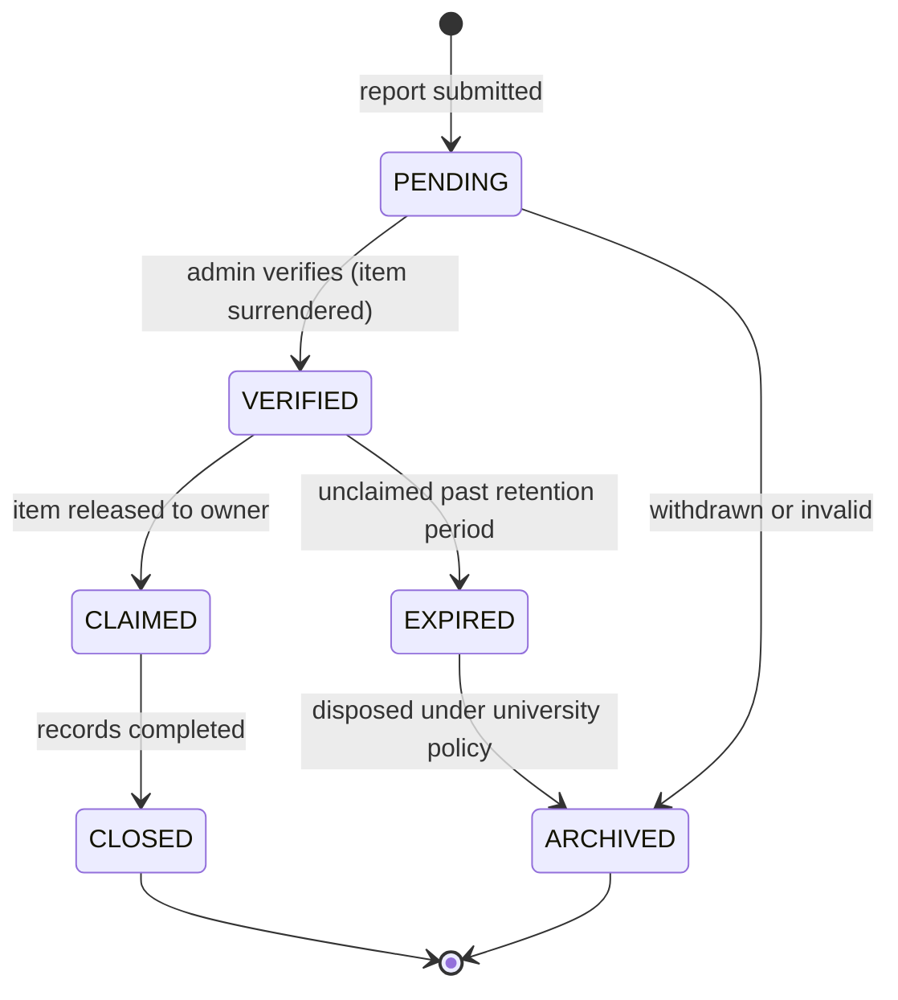
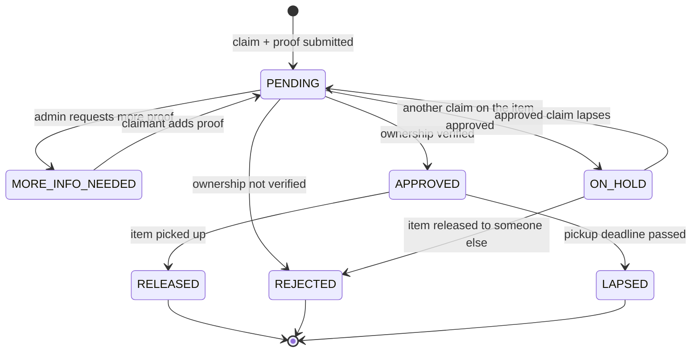
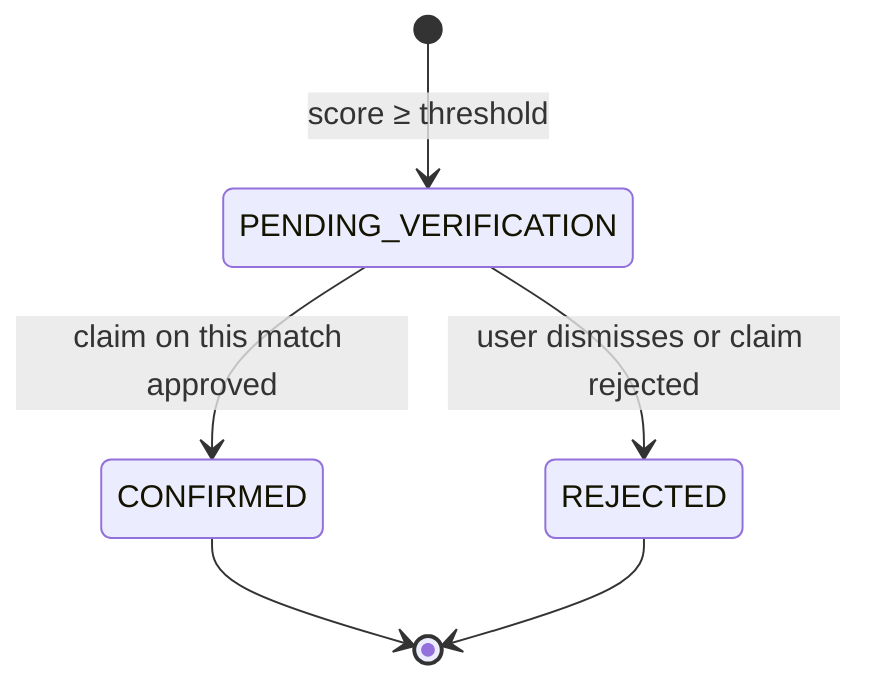
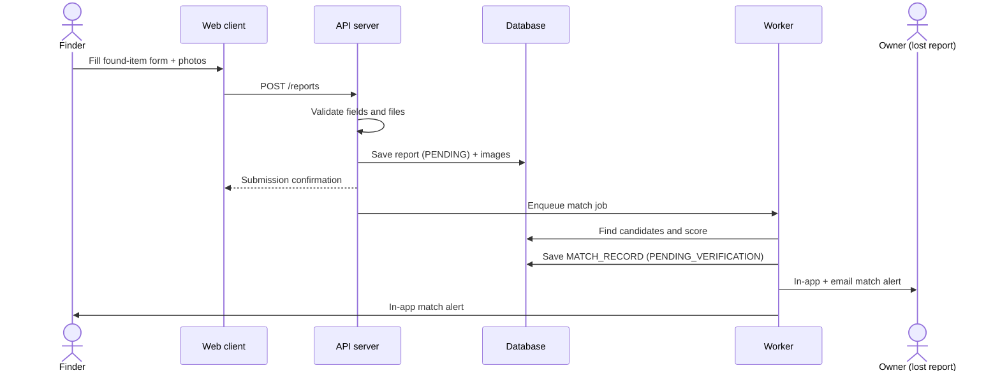
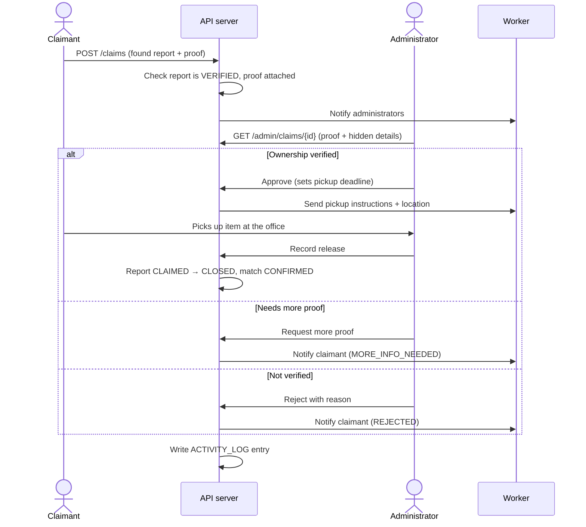
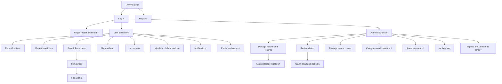

# ReturnDesk — System Design

**Web and Mobile-Based Lost and Found Management System for Bulacan State University – Main Campus**

Status: Draft v0.1 (before tech stack selection)
Sources: Chapter I (objectives, scope, limitations), Chapter III (Map/Table and Paper tabs), and the three Lucid diagrams (context diagram, system flowchart, ERD).

This document describes *what* ReturnDesk does and *how its parts fit together*, without committing to specific frameworks. Section 14 lists the decisions to settle in the tech stack discussion.

---

## Contents

1. [Goals and scope](#1-goals-and-scope)
2. [Users and roles](#2-users-and-roles)
3. [Functional requirements](#3-functional-requirements)
4. [Quality requirements (ISO/IEC 25010)](#4-quality-requirements-isoiec-25010)
5. [Architecture](#5-architecture)
6. [Modules](#6-modules)
7. [Data model](#7-data-model)
8. [Status lifecycles](#8-status-lifecycles)
9. [Matching engine](#9-matching-engine)
10. [Key flows](#10-key-flows)
11. [API surface](#11-api-surface)
12. [Screens (visual table of contents)](#12-screens-visual-table-of-contents)
13. [Security and data privacy](#13-security-and-data-privacy)
14. [Decisions for the tech stack discussion](#14-decisions-for-the-tech-stack-discussion)
15. [Testing plan](#15-testing-plan)
16. [Traceability to Chapter III](#16-traceability-to-chapter-iii)
17. [Open questions for the team](#17-open-questions-for-the-team)

---

## 1. Goals and scope

ReturnDesk replaces notice boards, verbal announcements, and social media posts with one authorized channel for lost and found items on BulSU – Main Campus.

**In scope (Chapter I objectives)**

| # | Capability | Objective |
|---|---|---|
| G1 | Lost and found item reporting with photos and categories | Obj. 2a |
| G2 | Item search with filters, and automated matching of lost and found reports | Obj. 2b, Obj. 3 |
| G3 | Claim submission with proof of ownership, verified by an administrator | Obj. 2c |
| G4 | Notifications for matches and claim updates | Obj. 2d |
| G5 | Administrative management, record keeping, and activity logs | Obj. 2e |
| G6 | Works on phones and computers (web and mobile) | General objective |

**Out of scope (Chapter I limitations)**

- Items lost outside the BulSU – Main Campus environment.
- Items that were never reported. Matching only works on reports in the database.
- Deciding ownership automatically. The system suggests matches; an administrator gives the final approval.
- Guaranteeing physical recovery. ReturnDesk records and matches items; the university's storage area holds them.
- Image-based (photo) matching. Text and attribute matching only for this version; see §9.4.

**Delivery form.** The prototype will be a live website. To meet the "web and mobile" objective with one codebase, it is designed as a **responsive web app installable as a PWA** (works in a phone browser and can be added to the home screen). A native mobile app stays optional (see §14).

---

## 2. Users and roles

| Role | Who | Can do |
|---|---|---|
| **User** (subtype: Student, Faculty, Staff) | Members of the campus community | Register and log in, report lost or found items, search, view their matches, file and track claims, read notifications, manage their profile |
| **Administrator** | Designated lost and found personnel | Everything a user can, plus: verify reports, review and decide claims, release items, assign storage locations, manage users and categories, view activity logs and reports |
| **Super administrator** (`admin_level`) | Head of the lost and found office or IT | Manage administrator accounts and system settings |
| *Guest* | Not logged in | View the landing page, log in, register, reset password. No item data. |

IT experts who evaluate the system for the ISO 25010 survey use test accounts; they are not a separate role.

The ERD models Student, Faculty, Staff, and Administrator as **disjoint subtypes of USER**, so one person has exactly one role.

---

## 3. Functional requirements

IDs are used in issues, commits, and the test plan.

### 3.1 Accounts (DFD process 1.0, flowchart page 1)

| ID | Requirement |
|---|---|
| FR-A1 | A person registers with ID number, name, email, password, role (student, faculty, staff), and college, plus the subtype fields (course and year level; department and academic rank; office and position). |
| FR-A2 | Email must be verified before the account can file reports or claims. |
| FR-A3 | Log in with email and password. Invalid credentials show an error and let the user retry. |
| FR-A4 | "Forgot password" sends a time-limited reset link to the registered email. |
| FR-A5 | After login, the system routes the user by role: users go to the user dashboard, administrators to the admin dashboard. |
| FR-A6 | Users can view and update their profile and contact details. |
| FR-A7 | Administrators can create, update, deactivate, and reactivate user accounts. |

### 3.2 Reporting (DFD 2.0, flowchart page 3)

| ID | Requirement |
|---|---|
| FR-R1 | A user files a **lost** or **found** report with item name, category, description, color, brand, date lost or found, location (building and area), and one or more photos. |
| FR-R2 | The form validates required fields, file type, and file size before saving and shows clear errors. |
| FR-R3 | On save, the user sees a submission confirmation, and the report enters the `PENDING` status. |
| FR-R4 | Saving a report triggers the matching engine (§9). |
| FR-R5 | The reporter can edit a report while it is `PENDING` or `VERIFIED`, and can withdraw it. Edits re-run matching. |
| FR-R6 | A person who finds an item is told to surrender it to the lost and found office. The administrator then marks the found report `VERIFIED` and assigns a storage location. |

### 3.3 Search and matching (DFD 3.0, flowchart pages 3 and 4)

| ID | Requirement |
|---|---|
| FR-S1 | Users search found items by keyword and filter by category (including subcategories), date range, and building. |
| FR-S2 | Public search results show **limited details** for found items (name, category, date, building, a cropped or blurred photo). Distinguishing details stay hidden so they can be used to verify ownership. |
| FR-S3 | The system automatically compares each new or edited report with open reports of the opposite type and records possible matches with a score (§9). |
| FR-S4 | Both reporters get a match alert. A lost-item owner can open the matched found report and start a claim from it. |
| FR-S5 | A match is only a suggestion. It never changes ownership or item status by itself. |
| FR-S6 | A user can dismiss a suggested match ("not my item"), which marks it `REJECTED`. |

### 3.4 Claims (DFD 4.0, flowchart pages 4 and 6)

| ID | Requirement |
|---|---|
| FR-C1 | A user files a claim on a `VERIFIED` found report and attaches proof of ownership: description of unique marks, photos, receipts, or other files. At least one proof is required. |
| FR-C2 | The claim is saved as `PENDING`, and administrators are notified. |
| FR-C3 | An administrator reviews pending claims with the proof side by side with the full found report, including its hidden details. |
| FR-C4 | The administrator decides: **approve**, **reject** (reason required), or **request more proof**. More proof sets the claim to `MORE_INFO_NEEDED` and notifies the claimant, who can add proof to send it back to review. |
| FR-C5 | On approval, the claimant receives pickup instructions, the storage location, and a pickup deadline. Other pending claims on the same item are put on hold. |
| FR-C6 | On pickup, the administrator records the release. The found report becomes `CLAIMED`, then `CLOSED`, together with the claimant's matching lost report if there is one. |
| FR-C7 | If the item isn't picked up by the deadline, the claim lapses and the administrator is alerted. |
| FR-C8 | Every decision is written to the activity log with the administrator, time, and remarks. |

### 3.5 Notifications (DFD 5.0)

| ID | Requirement |
|---|---|
| FR-N1 | In-app notifications with an unread badge, list view, and mark-as-read. |
| FR-N2 | Email copies for important events: account verification, password reset, match found, claim decision, more proof requested, pickup reminder. |
| FR-N3 | System announcements posted by administrators appear to all users. |

### 3.6 Administration and records (DFD 6.0, flowchart page 5)

| ID | Requirement |
|---|---|
| FR-M1 | Admin dashboard with counts: pending reports, pending claims, items in storage, items nearing expiry. |
| FR-M2 | Manage reports: verify, update status, assign storage location (building, room, storage bin), archive. |
| FR-M3 | Manage categories as a tree (parent and child categories). |
| FR-M4 | View and filter the activity log by user, action, entity, and date. |
| FR-M5 | List expired and unclaimed items for disposal under university policy. |
| FR-M6 | Export reports (CSV or PDF) for record keeping. |

---

## 4. Quality requirements (ISO/IEC 25010)

These turn the eight characteristics in the questionnaire into targets the team can test.

| Characteristic | Target for the prototype |
|---|---|
| Functional suitability | Every FR in §3 passes its functional test case. |
| Performance efficiency | Pages load in under 3 s and searches return in under 1 s on a typical campus connection, with 50 concurrent users. Photos are resized and compressed on upload. |
| Compatibility | Works on current Chrome, Edge, Firefox, and Safari, and on Android and iOS phone browsers. Email and maps integrate through standard APIs. |
| Usability (interaction capability) | A first-time user can file a report in under 2 minutes. Forms show inline errors. Text and contrast meet WCAG 2.1 AA. |
| Reliability | Daily database backups. Failed emails are retried. A crash in one module doesn't take down the site. |
| Security | Hashed passwords, role-based access, ownership checks on every record, HTTPS only, upload scanning and limits, rate-limited login. See §13. |
| Maintainability | Modular code that mirrors §6, automated tests, linting, and documented setup. |
| Portability (flexibility) | Installable as a PWA. Configuration through environment variables, so the app can move between hosting providers. |

---

## 5. Architecture

A **modular monolith**: one deployable backend with clearly separated modules, plus a background worker. It is simple enough for a five-person team and a semester timeline, and modules can be split out later if needed.

| Component | Responsibility |
|---|---|
| Web client | Responsive UI for users and administrators. Installable as a PWA. Talks to the API over HTTPS. |
| API server | Authentication, authorization, validation, business rules, and status changes. The only component that writes to the database. |
| Background worker | Runs slow or scheduled work off the request path: matching, sending emails, pickup reminders, expiry checks. |
| Job queue | Hands work from the API to the worker. Can start as a database table and move to a dedicated queue later. |
| Relational database | All records in §7. Relational because the ERD has many foreign keys and matching needs joins and text search. |
| Object storage | Report photos (public, resized) and claim proof files (private, accessed through short-lived signed links). |
| Email service | Transactional email (§3.5). |
| Map service | Optional campus map for picking a building or area. Location can work as a dropdown without it. |

**Environments:** `local` → `staging` (for the team and adviser testing) → `production` (the live site used in the evaluation).

---

## 6. Modules

The modules follow the six processes of the Level 1 DFD, so the code, the diagram, and the paper describe the same structure.

| Module | DFD process | Owns tables | Main responsibilities |
|---|---|---|---|
| `accounts` | 1.0 Manage Accounts | USER, STUDENT, FACULTY, STAFF, ADMINISTRATOR, COLLEGE | Registration, email verification, login, password reset, profiles, role routing |
| `reports` | 2.0 Report Items | REPORT, REPORT_IMAGE, CATEGORY, LOCATION | Report forms, validation, photo upload, edits, admin verification, storage assignment |
| `matching` | 3.0 Search and Match Items | MATCH_RECORD | Search and filters, match scoring, match alerts, dismissals |
| `claims` | 4.0 Verify Claims | CLAIM, CLAIM_PROOF | Claim filing, proof upload, review decisions, pickup and release |
| `notifications` | 5.0 Send Notifications | NOTIFICATION | In-app notifications, emails, announcements |
| `admin` | 6.0 Manage Records | ACTIVITY_LOG | Dashboard, user management, category management, activity log, exports, expiry lists |

Modules call each other only through their public functions, never through each other's tables. Each state change publishes an event (for example `claim.approved`) that `notifications` and `admin` listen to.

---

## 7. Data model

Based on the Lucid ERD (`Lenon_lost_found_system_erd`), including the fields added from the review: `CLAIM.rejection_reason`, `CLAIM.pickup_deadline`, `LOCATION.room_number`, `LOCATION.storage_bin`.

### 7.1 Tables

| Table | Key fields | Notes |
|---|---|---|
| `college` | college_id, college_name | Seeded with BulSU – Main Campus colleges |
| `user` | user_id, id_number (unique), first_name, last_name, email (unique), contact_no, password_hash, role, college_id, status, date_registered | `status`: `UNVERIFIED`, `ACTIVE`, `DEACTIVATED` |
| `student` / `faculty` / `staff` | user_id (PK, FK) + subtype fields | course, year_level / department, academic_rank / office, position |
| `administrator` | user_id (PK, FK), office, admin_level | `admin_level`: `ADMIN`, `SUPER_ADMIN` |
| `category` | category_id, category_name, parent_category_id | Tree, for example Electronics → Phones |
| `location` | location_id, building_name, area_description, room_number, storage_bin | Used both for where an item was lost or found and where it is stored. See open question Q3. |
| `report` | report_id, user_id, category_id, location_id, report_type, item_name, description, color, brand, date_lost_or_found, status, date_reported | `report_type`: `LOST`, `FOUND` |
| `report_image` | image_id, report_id, image_path, date_uploaded | Several per report |
| `match_record` | match_id, lost_report_id, found_report_id, match_score, match_status, date_matched | Unique on (lost_report_id, found_report_id) |
| `claim` | claim_id, report_id, claimant_id, reviewed_by, claim_date, claim_status, rejection_reason, remarks, date_reviewed, pickup_deadline | `report_id` points to the found report |
| `claim_proof` | proof_id, claim_id, proof_type, file_path, description, date_uploaded | Private files |
| `notification` | notification_id, user_id, report_id, claim_id, notification_type, message, is_read, date_sent | |
| `activity_log` | log_id, user_id, action, target_entity, target_id, date_logged | Append-only |

### 7.2 Additions proposed for implementation

These are not in the ERD yet. If the team agrees, they should be added to the Lucid ERD so the paper stays accurate.

| Addition | Why |
|---|---|
| `report.hidden_details` (text) | Distinguishing details that only the reporter and administrators see, used to check claims (FR-S2) |
| `report.storage_location_id` (FK → location) | Keeps "where it was found" separate from "where it is stored" (Q3) |
| `claim.date_released`, `claim.released_by` | Records the actual handover (FR-C6) |
| `announcement` table (announcement_id, admin_id, title, body, date_posted, is_active) | The context diagram has "Announcement details" and "System announcements" flows but the ERD has nowhere to store them |
| `auth_token` table (user_id, token_hash, purpose, expires_at) | Email verification and password reset links (FR-A2, FR-A4) |

---

## 8. Status lifecycles

The status values below follow Chapter I ("pending, verified, or claimed") and the flowcharts.

### 8.1 Report

For a **lost** report, `VERIFIED` means an administrator checked it, and it closes when its matched found item is released to that user, or when the user withdraws it.

> **Note for the flowchart:** page 6 currently says "Approve claim; set item status to Verified". In this lifecycle the found item is already `VERIFIED` when it is surrendered, and approving a claim changes the **claim** to `APPROVED`. Suggested wording for that box: "Approve claim; set claim status to Approved".

### 8.2 Claim

### 8.3 Match

---

## 9. Matching engine

### 9.1 When it runs

As a background job whenever a report is created or edited, and in a nightly batch for open reports. The user never waits for it.

### 9.2 Candidate selection

For a new report *R*, candidates are reports where:

- the type is opposite (`LOST` ↔ `FOUND`);
- the status is `PENDING` or `VERIFIED`;
- the category is the same as *R*'s, its parent, or one of its children;
- the found date is no earlier than 3 days before the lost date, and no more than 60 days after it (both configurable).

### 9.3 Scoring (0–100)

| Signal | Weight | How |
|---|---|---|
| Text similarity of item name + description | 45 | Normalized, stop words removed. Trigram or TF-IDF cosine similarity. |
| Category | 15 | Same category 15; parent or child 8 |
| Location | 15 | Same building and area 15; same building 10 |
| Date proximity | 10 | Linear decay over the date window |
| Color | 8 | Exact or synonym match ("black" / "itim") |
| Brand | 7 | Exact match, ignoring case |

- Pairs scoring at least **60** (configurable) are saved as `PENDING_VERIFICATION`. At most the **top 5** per report are saved, so users aren't flooded.
- The weights are a starting point. The **matching accuracy test** (§15) uses sample pairs to tune them, and the results can be reported in Chapter IV.
- Text and attribute matching is in line with the approach of Karn et al. (2026), cited in the paper.

### 9.4 Future work

Image similarity, as in LostNet (Zhou et al., 2024), can be added later as another scoring signal, without changing the rest of the design.

---

## 10. Key flows

### 10.1 Report a found item → match → alert

### 10.2 Claim → review → pickup

---

## 11. API surface

A REST-style API with JSON over HTTPS. Endpoints marked 🔒 need login; 🛡 needs the administrator role. Final paths and payloads are set once the stack is chosen.

| Method | Path | Purpose |
|---|---|---|
| POST | `/auth/register` | Register (FR-A1) |
| POST | `/auth/verify-email` | Confirm the email token (FR-A2) |
| POST | `/auth/login` · `/auth/logout` | Session (FR-A3) |
| POST | `/auth/forgot-password` · `/auth/reset-password` | Reset (FR-A4) |
| GET / PATCH | `/me` 🔒 | View or update profile (FR-A6) |
| GET | `/categories` · `/locations` 🔒 | Form options |
| POST | `/reports` 🔒 | Create a report with photos (FR-R1) |
| GET | `/reports/mine` 🔒 | My reports |
| GET / PATCH / DELETE | `/reports/{id}` 🔒 | View, edit, withdraw own report (FR-R5) |
| GET | `/search?q=&category=&from=&to=&building=` 🔒 | Search found items, limited details (FR-S1, FR-S2) |
| GET | `/matches/mine` 🔒 | My suggested matches (FR-S4) |
| POST | `/matches/{id}/dismiss` 🔒 | "Not my item" (FR-S6) |
| POST | `/claims` 🔒 | File a claim with proof (FR-C1) |
| GET | `/claims/mine` · `/claims/{id}` 🔒 | Track claims |
| POST | `/claims/{id}/proof` 🔒 | Add proof when more info is needed (FR-C4) |
| GET / POST | `/notifications` · `/notifications/{id}/read` 🔒 | Notifications (FR-N1) |
| GET | `/admin/dashboard` 🛡 | Counts (FR-M1) |
| GET / PATCH | `/admin/reports` · `/admin/reports/{id}` 🛡 | Verify, change status, assign storage (FR-M2) |
| GET | `/admin/claims?status=` 🛡 | Claims queue (FR-C3) |
| POST | `/admin/claims/{id}/approve` · `/reject` · `/request-info` · `/release` 🛡 | Claim decisions (FR-C4 to FR-C6) |
| CRUD | `/admin/users` · `/admin/categories` · `/admin/locations` · `/admin/announcements` 🛡 | Management (FR-A7, FR-M3, FR-N3) |
| GET | `/admin/activity-log` · `/admin/expired` · `/admin/exports` 🛡 | Records (FR-M4 to FR-M6) |

---

## 12. Screens (visual table of contents)

This tree is the basis for **Figure 7** in the paper. Screens marked † were added in this design (they come from the flowchart updates and §3) and should be added to the visual table of contents if the team agrees.

---

## 13. Security and data privacy

The system handles personal data and proof of ownership, so the Data Privacy Act of 2012 (RA 10173) applies.

**Authentication and sessions**
- Passwords hashed with Argon2id or bcrypt. Never stored or logged in plain text.
- Login rate-limited, with a temporary lockout after repeated failures.
- Reset and verification tokens are single-use, stored hashed, and expire within an hour.
- Secure, HTTP-only session cookies, or short-lived tokens. Decided with the stack.

**Authorization**
- Role checks on every admin endpoint.
- Ownership checks on every record. A user can see only their own reports, claims, proof, and notifications.
- Claim proof and `hidden_details` are visible only to the claimant or reporter and to administrators.

**Uploads**
- Only images (JPEG, PNG, WebP) and PDF; size limits (for example 5 MB per file, 5 files).
- Files renamed on upload, and image metadata (including GPS) removed.
- Proof files kept private and served through short-lived signed links.

**Data privacy (RA 10173)**
- Consent notice at registration explaining what is collected and why.
- Data minimization: only the fields in §7.
- Retention: closed and expired records are anonymized after a period the university sets (Q5).
- Users can request a copy of their data, or deletion of their account.
- The activity log records administrator actions on personal data.

**Platform**
- HTTPS everywhere; security headers (CSP, HSTS); input validation and parameterized queries; dependency updates; secrets kept in environment variables, never in the repository.

---

## 14. Decisions for the tech stack discussion

These are the choices to settle next, with the constraint from this design for each.

| Decision | Constraint from this design | Notes |
|---|---|---|
| Frontend | Responsive, installable as a PWA, works on phone browsers | The requirements table currently says React.js |
| Mobile approach | One codebase preferred for a semester project | PWA covers "mobile-based"; a Flutter app (listed in the requirements table) would be a second codebase |
| Backend | Modular monolith, background jobs, REST API | The requirements table lists Spring Boot or Node.js |
| Database | Relational: the ERD has 15 tables with foreign keys; matching needs joins and text search | The requirements table lists Firebase. Firestore is a document database and would make the ERD and matching harder; a relational database (for example PostgreSQL) fits the design better. Worth discussing. |
| File storage | Public photos plus private proof files with signed links | |
| Email | Transactional email with templates | |
| Maps | Optional | A building dropdown may be enough for the prototype |
| Hosting | Live website with staging and production; a free or student tier if possible | |
| Auth | Email verification, password reset, roles | Build in, or use a managed auth service |

Once these are chosen, sections 5 and 11 get filled in with concrete technologies, and Table 3 in the paper (Requirements) can drop its bracketed placeholders.

---

## 15. Testing plan

This maps the eight tests in the paper to this design.

| Test | What it covers here |
|---|---|
| Unit | Validation rules, status transitions (§8), match scoring functions (§9.3) |
| Integration | API ↔ database, report save → match job → notification, upload → storage |
| Functional | One test case per FR in §3 |
| Matching accuracy | A labeled set of sample lost and found pairs (true and false matches). Measure precision and recall at the threshold, then tune weights. |
| Security | Access to other users' records, admin endpoints as a normal user, login brute force, upload of disallowed file types |
| Compatibility | Browsers and phones listed in §4 |
| Performance | Page load and search times with 50 concurrent simulated users |
| User acceptance | ISO/IEC 25010 questionnaire with the respondents in Table 1 |

---

## 16. Traceability to Chapter III

| Chapter III item | Where it lives in this design |
|---|---|
| Figure 1 – Prototype Model | Development process: build → user evaluation → refine, tracked through GitHub issues and releases |
| Figure 2 – Context diagram | §2 roles, §5 architecture, §11 API |
| Figure 3 – Level 1 DFD (six processes) | §6 modules (one per process) |
| Figure 4 – EERD | §7 data model |
| Figures 5 and 6 – System flowcharts | §3 functional requirements, §8 lifecycles, §10 flows |
| Figure 7 – Visual table of contents | §12 screens |
| Table 3 – Requirements | §4 quality targets, §14 stack decisions |
| Testing section | §15 testing plan |

---

## 17. Open questions for the team

| # | Question | Default if not decided |
|---|---|---|
| Q1 | Must registration use a BulSU email domain, or any email plus an ID number? | Any email, ID number required, admin can deactivate |
| Q2 | Can found-item reporters keep the item, or must every found item be surrendered to the office? | Must be surrendered (matches the operational requirement for a storage area) |
| Q3 | Should "where it was found" and "where it is stored" be separate fields? | Yes; add `storage_location_id` (§7.2) |
| Q4 | Retention period before an unclaimed item is marked expired? | 60 days |
| Q5 | Retention period for personal data after a record closes? | 1 year, then anonymize |
| Q6 | Who are the actual administrators (office, number of accounts)? | One office, two or three admin accounts |
| Q7 | Is Filipino text expected in reports (affects text matching and color synonyms)? | Support both English and common Filipino terms |
